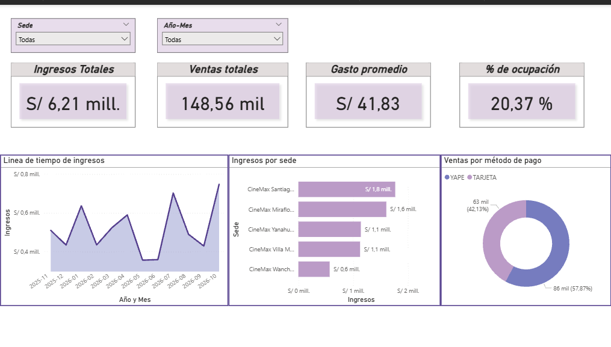
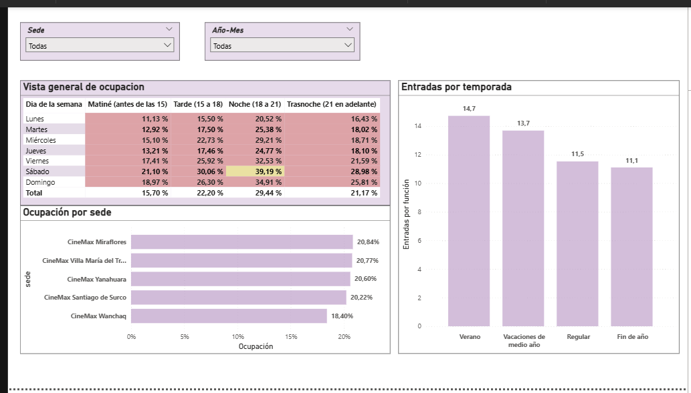
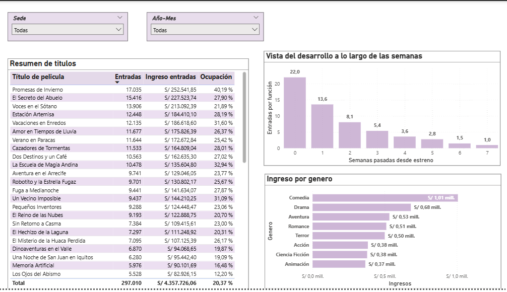
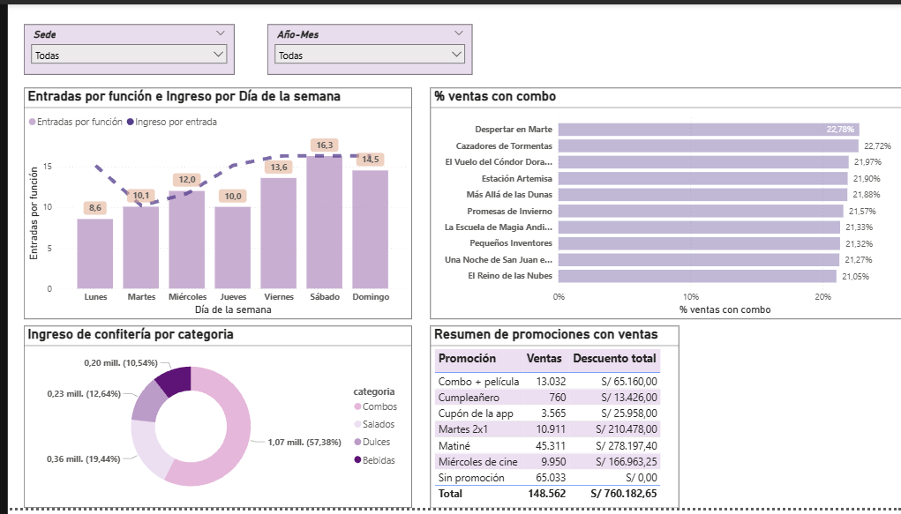

# CineMax Analytics

Warehouse, dashboard y agente de consultas sobre los datos de [CineMax](https://github.com/JLCCAST/CineMax), un sistema de venta de entradas de cine hecho con microservicios en Spring Boot. CineMax fue un proyecto de grupo en la universidad; este repo usa mi fork.

CineMax reparte sus datos en cinco bases de tres motores: usuarios y facturación en PostgreSQL, sucursales y confitería en MySQL, y cartelera en MongoDB. Este proyecto las integra en un warehouse para analizar ventas, ocupación de salas y promociones.

Las ventas son sintéticas. El generador escribe directo en las bases de CineMax con sus mismas reglas de tarifas, promociones y butacas, y el dashboard tiene que recuperar los patrones que se configuran en el generador. Es una prueba del pipeline completo, no un estudio de mercado.

## Cómo está armado

```
5 bases de CineMax (Docker) -> extracción (Python) -> raw -> dbt: staging -> marts -> Power BI
                                                                             -> agente text-to-SQL
```

- `docker-compose.yml`: las 5 bases, creadas con las migraciones de Flyway de CineMax (submódulo `cinemax/`), y el warehouse en PostgreSQL 16.
- `src/cinemax_analytics/extraccion`: copia las fuentes al esquema `raw`. MongoDB entra como JSONB y de los usuarios no se copian datos personales.
- `dbt/`: staging de cada fuente, `dim_fecha` con los feriados de Perú y pruebas de calidad (claves, relaciones entre bases distintas y que cada venta cuadre con sus líneas).
- `src/cinemax_analytics/generador`: un año de ventas sintéticas (unas 150 000) con 3 sedes nuevas, 52 películas inventadas y 20 000 clientes. Usa las tarifas y el motor de promociones de CineMax pasados a Python, comprobados contra compras reales del sistema. Con la misma semilla da exactamente los mismos datos. Los parámetros de demanda están en `generador/parametros.py`.

## Calidad de datos

`dbt/models/calidad` revisa 14 problemas posibles: copias incompletas, texto mal codificado, contadores de butacas que no cuadran, ids huérfanos entre bases, ventas que no cuadran con sus líneas o pagadas después de la función, y precios fuera de tarifa. Para probarlo, `python -m cinemax_analytics.generador.defectos` mete esos defectos con tasas conocidas, y `scripts/reporte_calidad.py` compara lo inyectado con lo detectado. Hoy cada chequeo encuentra exactamente lo inyectado.

## Dashboard

Modelo estrella en `dbt/models/marts`: cuatro hechos (`fact_ticket`, `fact_venta`, `fact_confiteria` y `fact_ocupacion_funcion`) y sus dimensiones. Power BI lo importa desde el warehouse; las medidas están en `powerbi/medidas.dax`, y `dbt/analyses` tiene las consultas SQL que sirven para comprobar las cifras del dashboard. Datos de noviembre de 2025 a octubre de 2026.

**Resumen.** S/ 6,21 millones en 148 562 compras, con un gasto promedio de S/ 41,83 y una ocupación media de 20,4 %. El 58 % paga con Yape. Santiago de Surco es la sede que más vende (S/ 1,8 mill.); Wanchaq vende menos porque abrió en mayo. Los altibajos de cada mes siguen a la cartelera, más que a la temporada.



**Ocupación.** Las noches se llenan casi el doble que las matinés (29 % frente a 16 %), y el sábado en la noche es el pico (39 %). El verano es la temporada con más público por función (14,7 entradas). Fin de año queda por debajo de una semana normal aunque el generador le da más demanda: en diciembre la cartelera fue más débil, y ese efecto se come al de la temporada.



**Películas y estrenos.** Una película pierde cerca de 40 % de su público por función cada semana desde el estreno (22,0, 13,6, 8,1 y 5,4 entradas por función en las semanas 0 a 3). Es la retención de 0,60 que tiene el generador. Comedia es el género que más ingresa (S/ 1,01 mill.), repartiendo cada película entre sus géneros.



**Confitería y promociones.** El 47 % de las compras con entradas lleva confitería, y los combos son el 57 % de ese ingreso. El combo depende del tamaño del grupo: lo lleva el 5 % de las compras de una entrada, el 22 % de las de dos y cerca del 40 % de las de tres o más. El 56 % de las compras usa alguna promoción. La Matiné se aplica en 3 de cada 10 y es la que más descuenta (S/ 278 mil de S/ 760 mil). Martes y miércoles cobran S/ 10 a 12 por entrada, frente a S/ 16 el fin de semana, y venden más que lunes y jueves.



## Cómo correrlo

Hace falta Docker y [uv](https://docs.astral.sh/uv/).

```bash
git clone --recurse-submodules https://github.com/JLCCAST/cinemax-analytics.git
cd cinemax-analytics
cp .env.example .env    # cambia las contraseñas
docker compose up -d
uv run python scripts/smoke_fuentes.py
uv run python -m cinemax_analytics.generador --semilla 42 --desde 2025-11-01 --hasta 2026-10-31
uv run python scripts/smoke_fuentes.py --generado
uv run python -m cinemax_analytics.extraccion
uv run --env-file .env dbt build
uv run python scripts/reporte_calidad.py
uv run pytest
```

## Avance

- [x] Entorno, extracción y staging en dbt
- [x] Generador de ventas sintéticas
- [x] Calidad de datos y conciliación
- [x] Modelo estrella y dashboard en Power BI
- [ ] Agente de text-to-SQL con LangGraph y su evaluación
- [ ] Orquestación con Airflow
